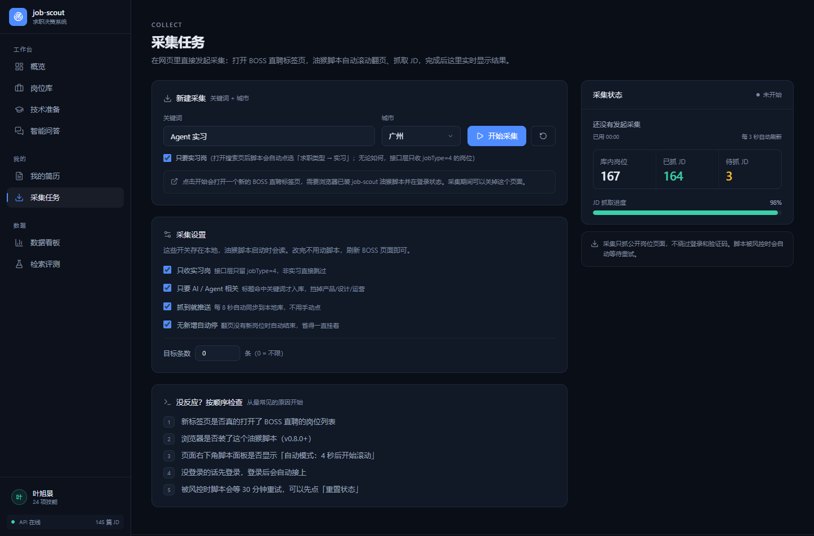

# job-scout

> 把「投简历」变成可量化的决策 —— 采集真实招聘 JD，用 RAG 做检索问答；上传简历后，用 LLM **读你项目的真实代码**，告诉你每个岗位值不值得投、简历该怎么改、招呼语怎么写。

<p align="center">
  
</p>

## 这是什么

找工作最难的不是投简历，是**不知道投哪个、不知道该补什么**。

市面上的岗位列表只回答「有什么岗位」，回答不了：

- 这个岗位值不值得投？我的差距在哪？
- 我简历里这个项目，够不够撑这个岗？
- 招呼语怎么写才不像群发？
- 我该补什么、什么不值得补？

这个项目用爬来的真实数据 + RAG + **ReAct 读代码**，把这四个问题变成可执行的判断。

## 核心流程

投递助手是递进的三步，后一步依赖前一步的结论：

```
① 匹配度  ──→  ② 简历建议  ──→  ③ 招呼语
  15 秒          70–90 秒         15–30 秒
  打分+缺口     读你的代码改简历   200–300 字
```

**没做②就不给写③**——招呼语会引用②里改过的措辞，直接写容易像群发。

<p align="center">
  
</p>

## 功能

### 采集与数据

- 油猴脚本旁听 BOSS 直聘接口响应，**不注入请求、不绕过验证码**
- 只收 `jobType=4`（实习）+ 标题含 AI/Agent 关键词，挡掉产品/设计/运营噪音
- JD 正文三级降级：`detail.json` 接口 → 整页 HTML → 「导航模式」真开详情页读 DOM
- 风控按返回码分级：`code 9`（频率限制）睡 5 分钟继续，其他码连续 2 次整体停
- JD 清洗：去 CSS 规则、去 `kanzhun`/`boss` 反爬水印、去「微信扫码分享」这类杂质
- 超长 JD（>2000 字）用 LLM 抽成「职责 / 要求 / 加分项」，3295 字压到 795 字
- 每天增量更新，超过 7 天没再出现自动标记停招

### 检索与问答

- 一条 JD = 一个 chunk，标题/公司/技能作为检索信号
- BM25 + 向量双路召回，RRF 融合（MRR 0.861 → 0.940）
- 自适应重排：Top1/Top2 分差 > 0.05 就跳过 LLM 重排，省一次调用
- 回答带引用编号 `[1]`，可点回原岗位；检索不到就明确说没有
- 检索条数可调（3–20 条），回答引用和检索结果分开显示

### 求职助手

| 能力 | 说明 |
|---|---|
| **我的画像** | 上传 PDF → 提取技能/项目/经历，bullet 逐条照搬原文 |
| **岗位匹配** | 0-100 分 + 匹配点 + 缺口清单 |
| **简历建议** | ReAct 读项目代码 → 原文→改后→依据 |
| **打招呼** | 结合简历建议生成，可提建议让 AI 重写 |
| **公司画像** | 在做什么 / 技术风格 / 团队特征 / 面试考什么 |
| **技术准备** | 该补什么、怎么学、什么不值得学 |

### 浏览器悬浮窗

在 BOSS 页面上随手刷的时候：

- **岗位快评**（详情页左下角）：点一下出匹配度、匹配点、缺口，还能直接问「这岗值得投吗」
- **抓取当前岗位入库**（右下角面板）：刷到合适的，一键存进来
- 采集面板已精简到 3 个按钮，开关统一在网页「采集任务」页设置

<p align="center">
  
</p>

## 截图

| | |
|---|---|
|  |  |
| 岗位列表 | 简历画像 |
|  |  |
| 公司画像 | 技术准备 |
|  |  |
| 带引用问答 | 数据看板 |

## 架构

```
┌──────────────────────────────────────────────────┐
│  Next.js (web/)          11 个页面                │
│  概览 / 岗位 / 准备 / 问答 / 我的 / 采集 / 看板    │
└───────────────────┬──────────────────────────────┘
                    │ REST + SSE
┌───────────────────▼──────────────────────────────┐
│  FastAPI (api/)                                   │
│  search ask jobs collect profile match company    │
│  code analyze                                     │
└───────────────────┬──────────────────────────────┘
                    │
┌───────────────────▼──────────────────────────────┐
│  RAG 与业务逻辑 (src/job_scout/)                  │
│  corpus → bm25 + vector → RRF → generate         │
│  profile → match / greet / rewrite               │
│  codereact → ReAct 读代码（预扫描 / 按岗分析）    │
│  company → signals → profile / prep              │
└───────────────────┬──────────────────────────────┘
                    │
┌───────────────────▼──────────────────────────────┐
│  SQLite + 向量索引 + 本地简历文件 + 项目代码档案   │
└──────────────────────────────────────────────────┘
```

采集在宿主机完成（油猴脚本 + 本地接收服务），API 进程内嵌 8766 端口接收脚本推送。

## 技术要点

### ReAct 读代码：让模型自己决定读什么

简历上的项目描述往往和代码脱节。与其让 LLM 猜，不如给它工具，让它自己读。

```
┌─────────┐                              ┌─────────┐
│  系统   │                              │   LLM   │
└────┬────┘                              └────┬────┘
     │ ① 开场：文件树 + 工具清单 + 规则        │
     │─────────────────────────────────────>│
     │                  tool_calls:list_dir  │
     │ <────────────────────────────────────│
     │ ② 执行工具，把结果追加进 messages        │
     │─────────────────────────────────────>│
     │              tool_calls:read_file     │
     │ <────────────────────────────────────│
     │ ③ 循环直到模型不再调工具                 │
     │─────────────────────────────────────>│
     │ <──────────────────── markdown 结论   │
```

用的是**原生 function calling**，三个工具：

| 工具 | 用途 |
|---|---|
| `list_dir` | 列目录（最多 2 次，文件树开场就给） |
| `read_file` | 读文件，单次最多 300 行，可指定行范围续读 |
| `grep` | 搜字符串，追调用链 |

**两个场景**：

| 场景 | 触发 | 轮次 | 产出 |
|---|---|---|---|
| 预扫描 | 关联文件夹时 | 20 | 技术偏向 + 项目结构 + 核心实现 + 适合投什么岗位 |
| 按岗分析 | 点「简历建议」时 | 12 | 与岗位相关的实现 + 简历该怎么改 |

**三重防失控**：

1. 轮次上限（预扫描 20 / 按岗 12）
2. 上下文 90K 字符强制收尾，追加「立刻停止调用工具」
3. `list_dir` 最多 2 次（超了返回提示）

外加**只读沙箱**：所有路径必须在项目根内，越界直接拒绝。

实测：

```
预扫描：18 轮自然收敛（没跑满 20），32 次调用，读 20 个文件，46.9 秒
按岗分析：12 轮，22 次调用，读 13 个文件，62.2 秒
```

**它读出来的东西长这样**：

> **反风控是「架构选择」而不是「重试策略」**
>
> 程序自己 launch 浏览器 → 指纹是「受控浏览器」，直接给验证页；所以改成连接用户自己启动的浏览器（独立 `--user-data-dir` 不污染日常 profile），并且不注入请求、只监听页面自己发出的 XHR。

> 关浏览器时**绝不按进程名杀**，而是按「命令行含 `remote-debugging-port=9222`」精确匹配 PowerShell kill，避免误伤用户日常浏览器。

### 检索：为什么用 RRF 而不是加权求和

BM25 分数和余弦相似度量纲不同，直接加权需要反复调参。RRF 只看排名，天然可比。

| 配置 | Recall@10 | Precision@10 | MRR |
|---|---|---|---|
| BM25 | 0.579 | 0.589 | 0.866 |
| 向量（bge-small-zh） | 0.339 | 0.404 | 0.842 |
| **RRF 融合** | 0.537 | **0.639** | **0.940** |

- **向量单独用反而不如 BM25**：查询以专有名词为主（LangGraph、MCP），词法匹配更准
- 技能类查询 Precision@10 = **1.000**

### 生成：防幻觉

- 只依据检索到的片段，提示词禁止升级措辞（「参与」不能写成「负责」）
- 必须标引用编号，越界编号忽略
- 没有检索结果就明确拒答

忠实度 **93.1%**（29 条 LLM-as-judge）。

> 调试时踩过两个**评测侧**的 bug：生成时把 JD 截断在 1200 字（最长 3245 字），
> judge 又把 context 截在 3000 字（实际 12000 字）。修完忠实度从 62% 回到 93%。

### 招呼语：三次调用压成一次

超长 JD 有 LLM 洗过的精简版；简历建议支持复用（前端跑过就不再算）。

```
不复用：70.3 秒
复用：  13.8 秒  ← 省 56.5 秒
```

字数控制不靠模型自觉：超了就带反馈重试一次（「上一版 339 字，压到 300 以内」）。

### 负优化也是结果

试过 LLM listwise 重排：MRR 从 0.938 掉到 0.901，且一次调用要 80 秒。
**结论是不可用，改成默认关闭**，保留 `--rerank` 开关。

## 快速开始

### 环境

- Python 3.12+（用 [uv](https://docs.astral.sh/uv/) 管理）
- Node.js 22+ / pnpm
- Docker Desktop（用一键启动的话）
- 可选：DeepSeek 或任意 OpenAI 兼容 API Key（没有则降级为抽取式回答）

### Windows 一键启动

装好 Docker Desktop 后，**双击 `start.bat`**：

```
job-scout
==========

[..] Starting containers...
[OK] Services are up.

Web    http://localhost:3000
API    http://127.0.0.1:8001/docs
Crawl  http://localhost:3000/collect
```

浏览器会自动打开。停止双击 `stop.bat`。

### 手动运行（开发用）

```bash
git clone <repo>
cd job-scout

# 后端
uv sync
cp .env.example .env        # 填入 OPENAI_API_KEY
uv run uvicorn api.app.main:app --port 8001

# 前端
cd web && pnpm install && pnpm dev
```

### 采集数据

1. 浏览器安装 [Tampermonkey](https://www.tampermonkey.net/)，导入 `userscripts/job-scout.user.js`（v0.10.9+）
2. 登录 BOSS 直聘
3. 打开 http://localhost:3000/collect，选关键词和城市，点「开始采集」

脚本会自动点选「求职类型 → 实习」、滚动翻页、抓 JD 正文。

### 关联项目代码（可选，但强烈建议）

1. `/profile` → 拉到「项目代码」
2. 每个项目点「选择文件夹」→ 选对应目录
3. 等 50 秒，模型会自己读代码生成技术画像

之后点「简历建议」，改写的依据就来自你真实的代码。

## 常用命令

```bash
job-scout daily                 # 每日增量更新
job-scout cleanup --yes         # 清理非实习/无关岗位
job-scout dashboard             # 生成静态看板
job-scout rag-eval              # 检索评测
job-scout rag-eval --rebuild    # 重建向量索引
```

## 目录

```
src/job_scout/
├── rag/            检索与生成
│   ├── corpus.py      语料构建（一条 JD = 一个 chunk）
│   ├── bm25.py        中文 BM25
│   ├── embedder.py    bge-small-zh 本地向量化
│   ├── hybrid.py      RRF 融合 + 自适应重排
│   ├── generate.py    上下文组装 / 引用解析 / 拒答
│   ├── evaluate.py    评测集 + Recall/Precision/MRR
│   └── pipeline.py    统一入口
├── codereact.py    ReAct 读代码（预扫描 / 按岗分析）
├── codebase.py     项目扫描、目录浏览、代码摘要
├── profile.py      简历解析 / 匹配 / 招呼语 / 改写
├── company.py      公司画像 / 技术准备
├── textclean.py    JD 清洗（CSS / 水印 / 超长裁剪）
├── storage.py      SQLite（含迁移）
├── server.py       采集接收服务
└── classify.py     岗位方向分类

api/app/routers/    FastAPI 路由
web/app/            Next.js 页面
userscripts/        油猴脚本
docs/               设计文档与截图
```

## 设计取舍

**一条 JD = 一个 chunk**
JD 是完整语义单元，按 token 硬切会破坏「岗位职责 / 任职要求」结构。

**结构化字段作为检索信号**
标题、公司、城市、技能是免费的高质量信号。A/B 实验：加上后 MRR 0.723 → 0.864。

**简历只提取不重写**
整篇重写会丢真实经历，面试一问就露馅。系统只给「原文 → 改写 → 为什么」。

**代码分析交给模型读，不做规则抽取**
早期用正则抽类名/函数名，模型看到的是「run_pipeline」这种碎片，只能猜。
改成 ReAct 后它能说出「为什么用 RRF 而不是加权求和」。

**LLM 重排默认关闭**
实测负优化 + 80 秒延迟。数据说话，不硬上。

## 已知限制

- 评测集只有约 30 条，指标有波动
- 向量模型是 bge-small-zh（512 维），长文本召回一般
- 采集依赖浏览器登录态，无法完全无人值守
- 公司画像基于 JD 推断，岗位数少的公司结论不可靠
- 按岗分析只跑最相关的 1 个项目（3 个全跑要 3 分钟）
- 招呼语字数控制不稳定，偶尔超 300 字
- 容器只挂载了 F: 盘，要访问别的盘得改 `docker-compose.yml` 的 volumes

## 免责声明

- 本项目仅供个人求职参考，**请勿用于商业用途或高频抓取**
- 采集采用低频人工触发，不绕过任何验证码或风控
- 数据存于本地 SQLite，不上传任何第三方
- 使用前请确认符合目标网站的用户协议，风险自负

## License

MIT
