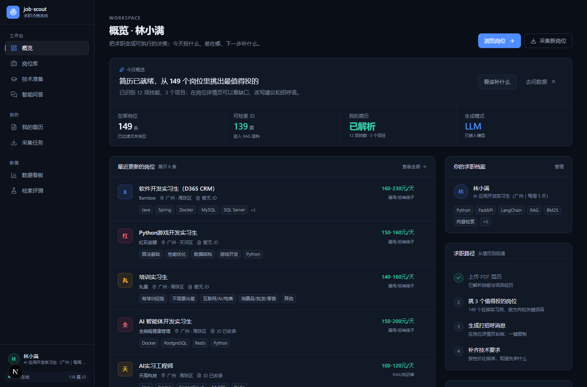
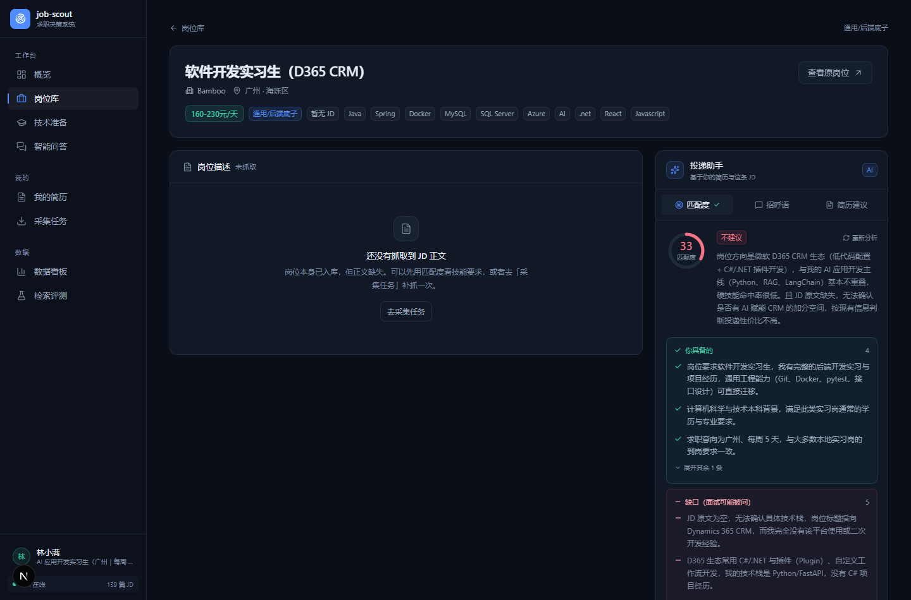
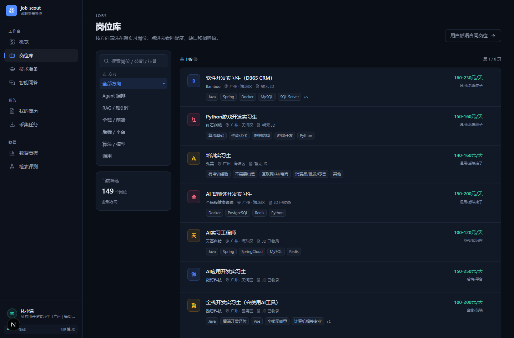
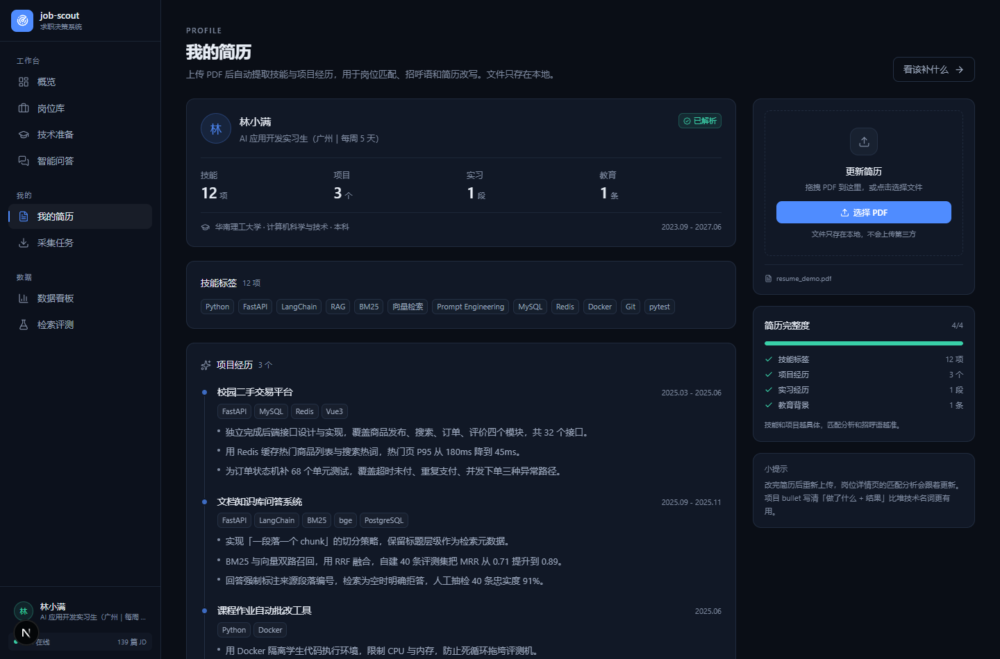
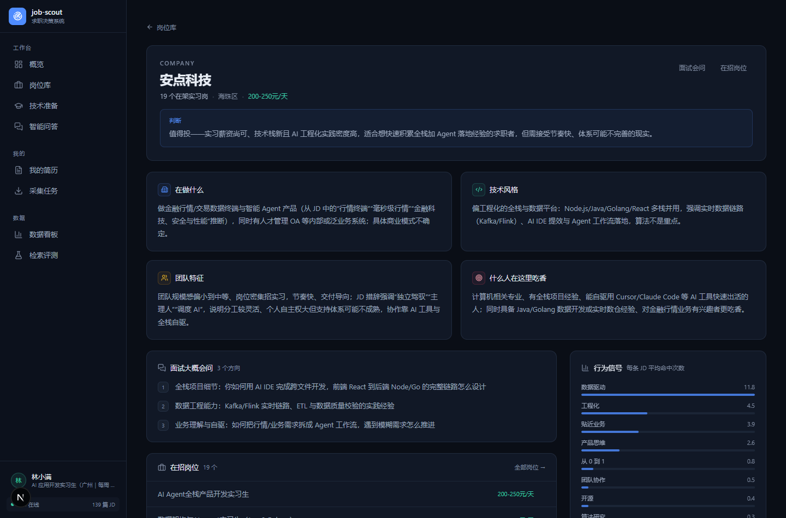
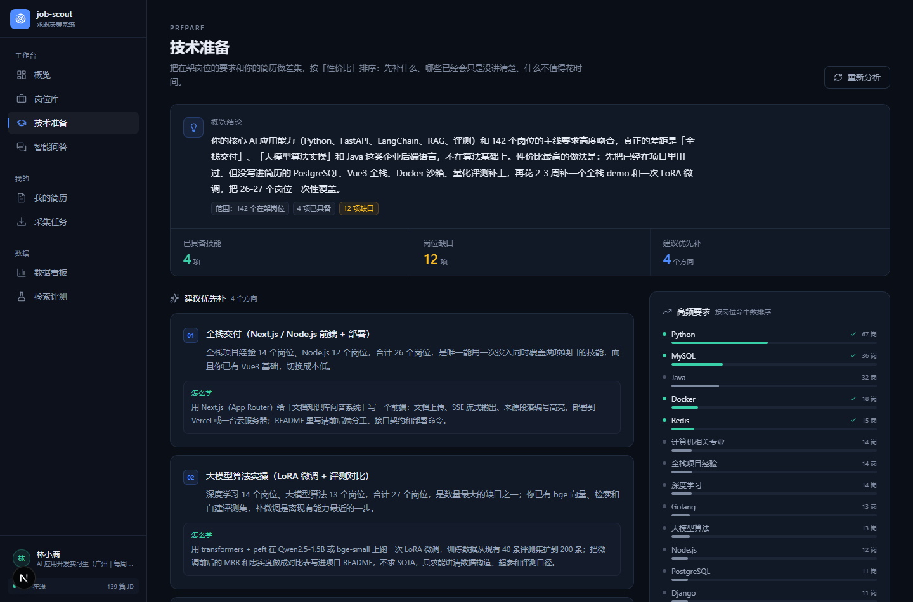
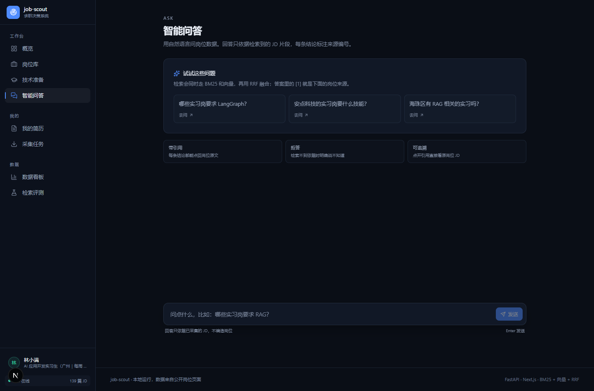
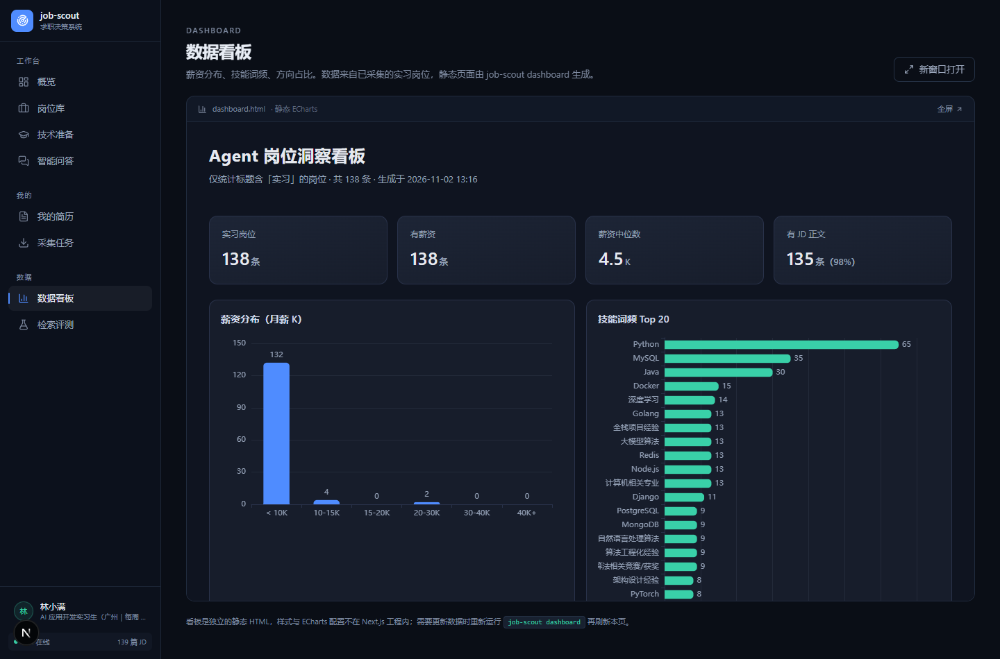

# job-scout

> 把「找工作」变成可量化的决策 —— 采集真实招聘 JD，用 RAG 做检索问答，上传简历后给每个岗位算匹配度、生成打招呼消息、指出简历该怎么改。

<p align="center">
  
</p>

## 这是什么

找工作最难的不是投简历，是**不知道投哪个、不知道该补什么**。

市面上的岗位列表只回答「有什么岗位」，回答不了：

- 这个岗位值不值得投？我的差距在哪？
- 这家公司在做什么、喜欢什么样的人？
- 招呼语怎么写才不像群发？
- 我该补什么、什么不值得补？

这个项目用爬来的真实数据 + RAG + LLM，把这四个问题变成可执行的判断。

## 功能

### 采集与数据

- 浏览器油猴脚本旁听 BOSS 直聘接口响应，**不注入请求、不绕过验证码**
- 只收 `jobType=4`（实习）+ 标题含 AI/Agent 关键词，挡掉产品/设计/运营类噪音
- JD 正文用「真实导航到详情页再读 DOM」的方式抓，避开接口风控
- 每天增量更新，超过 7 天没再出现自动标记停招

### 检索与问答

- 一条 JD = 一个 chunk，标题/公司/技能作为检索信号
- BM25 + 向量双路召回，RRF 融合
- 回答带引用编号 `[1]`，可点回原岗位
- 检索不到就明确说没有，不硬答

### 求职助手

| 能力 | 说明 |
|---|---|
| **我的画像** | 上传 PDF 简历 → 提取技能/项目/经历 |
| **岗位匹配** | 0-100 分 + 匹配点 + 缺口清单 |
| **打招呼** | 200 字内定制消息，必须扣 JD 的具体要求 |
| **简历改写** | 原文 → 改写 → 为什么，只调表达不编经历 |
| **公司画像** | 在做什么 / 技术风格 / 团队特征 / 面试考什么 |
| **技术准备** | 该补什么、怎么学、什么不值得学 |

<p align="center">
  
</p>

## 截图

| | |
|---|---|
|  |  |
| 岗位列表 | 简历画像 |
|  |  |
| 公司画像 | 技术准备 |
|  |  |
| 带引用问答 | 数据看板 |

## 架构

```
┌──────────────────────────────────────────────────┐
│  Next.js (web/)          11 个页面                │
│  概览 / 岗位 / 准备 / 问答 / 我的 / 采集 / 看板    │
└───────────────────┬──────────────────────────────┘
                    │ REST + SSE
┌───────────────────▼──────────────────────────────┐
│  FastAPI (api/)                                   │
│  search ask jobs collect profile match company    │
└───────────────────┬──────────────────────────────┘
                    │
┌───────────────────▼──────────────────────────────┐
│  RAG 与业务逻辑 (src/job_scout/)                  │
│  corpus → bm25 + vector → RRF → generate         │
│  profile → match / greet / rewrite               │
│  company → signals → profile / prep              │
└───────────────────┬──────────────────────────────┘
                    │
┌───────────────────▼──────────────────────────────┐
│  SQLite + 向量索引 + 本地简历文件                  │
└──────────────────────────────────────────────────┘
```

采集在宿主机完成（油猴脚本 + 本地接收服务），API 进程内嵌 8765 端口接收脚本推送。

## 界面

设计参考了三个方向：

| 参考 | 学到的 |
|---|---|
| [Linear 设计刷新](https://linear.app/now/behind-the-latest-design-refresh) | 导航「退后」，主内容优先：侧栏更暗、未激活项降饱和、用留白代替分隔线 |
| [Vercel Dashboard 导航](https://vercel.com/changelog/dashboard-navigation-redesign-rollout) | 持久左侧栏 + 统一页头 + 移动端底部浮动栏 |
| [招聘产品职位卡](https://jiedastudio.com/share/ui-design/career-go-application-context-u032) | 岗位身份（岗位/公司/地点/薪资）在任何场景都不能丢，阅读顺序固定 |

落地：232px 分组侧栏、统一 `PageHeader`、`shadcn/ui` 式的 token 体系
（`ink/panel/panel2/line/fg1-3` + 圆角 8/12/16）、`lucide-react` 图标（按需 tree-shake）。

关键布局决策：

- **详情页**：JD 阅读列 + 右侧 368px 粘性「投递助手」，匹配度和招呼语不用滚到底
- **岗位列表**：左侧粘性筛选栏 + 高密度行（标题 14px / meta 12px / 薪资右对齐）
- **概览**：简报卡 + 4 指标内嵌条 + 双栏（最近岗位 / 档案 + 路径 + 工具）
- **移动端**：5 项固定底栏，详情页把投递助手提到 JD 前面

## 技术要点

### 检索：为什么用 RRF 而不是加权求和

BM25 分数和余弦相似度量纲不同，直接加权需要反复调参。RRF 只看排名，天然可比。

| 配置 | Recall@10 | Precision@10 | MRR |
|---|---|---|---|
| BM25 | 0.570 | 0.670 | 0.861 |
| 向量（bge-small-zh） | 0.348 | 0.411 | 0.777 |
| **RRF 融合** | 0.521 | **0.656** | **0.938** |

- 融合把 MRR 提升 **8.9%**
- **向量单独用反而不如 BM25**：查询以专有名词为主（LangGraph、MCP），词法匹配更准
- 技能类查询 Precision@10 = **1.000**

### 评测：分类型指标

「哪些岗位要 Python」有 118 个正确答案，用 Recall@10 评价不公平（上限只有 0.085）。
这类开放型查询看 Precision，公司/区域类封闭查询看 Recall + MRR。

评测集约 30 条，规则合成，`job-scout rag-eval` 一键重跑，**4 秒**跑完。

### 生成：防幻觉

- 只依据检索到的片段，提示词禁止升级措辞（「参与」不能写成「负责」）
- 必须标引用编号，越界编号忽略
- 没有检索结果就明确拒答

忠实度 **93.1%**（29 条 LLM-as-judge）。

> 调试时踩过两个**评测侧**的 bug：生成时把 JD 截断在 1200 字（最长 3245 字），
> judge 又把 context 截在 3000 字（实际 12000 字）。修完忠实度从 62% 回到 93%。
> 教训：指标异常先查评测管线。

### 负优化也是结果

试过 LLM listwise 重排：MRR 从 0.938 掉到 0.901，且一次调用要 80 秒。
**结论是不可用，改成默认关闭**，保留 `--rerank` 开关。

## 快速开始

### 环境

- Python 3.12+（用 [uv](https://docs.astral.sh/uv/) 管理）
- Node.js 22+ / pnpm
- 可选：DeepSeek 或任意 OpenAI 兼容 API Key（没有则降级为抽取式回答）

### 本地运行

```bash
git clone <repo>
cd job-scout

# 后端
uv sync
cp .env.example .env        # 填入 OPENAI_API_KEY
uv run uvicorn api.app.main:app --port 8001

# 前端
cd web && pnpm install && pnpm dev
```

打开 http://localhost:3000

### Docker

```bash
docker compose up --build -d
```

### 采集数据

1. 浏览器安装 [Tampermonkey](https://www.tampermonkey.net/)，导入 `userscripts/job-scout.user.js`
2. 登录 BOSS 直聘
3. 打开 http://localhost:3000/collect，选关键词和城市，点「开始采集」

脚本会自动滚动翻页、抓 JD 正文，完成后页面显示进度和结果。

每日自动更新：`.\install-daily-task.ps1`（Windows 计划任务）。

## 常用命令

```bash
job-scout daily                 # 每日增量更新
job-scout cleanup --yes         # 清理非实习/无关岗位
job-scout dashboard             # 生成静态看板
job-scout rag-eval              # 检索评测
job-scout rag-eval --rebuild    # 重建向量索引
```

## 目录

```
src/job_scout/
├── rag/            检索与生成
│   ├── corpus.py      语料构建（一条 JD = 一个 chunk）
│   ├── bm25.py        中文 BM25
│   ├── embedder.py    bge-small-zh 本地向量化
│   ├── hybrid.py      RRF 融合
│   ├── generate.py    上下文组装 / 引用解析 / 拒答
│   ├── evaluate.py    评测集 + Recall/Precision/MRR
│   └── pipeline.py    统一入口
├── profile.py      简历解析 / 匹配 / 招呼语 / 改写
├── company.py      公司画像 / 技术准备
├── storage.py      SQLite（含迁移）
├── server.py       采集接收服务
└── classify.py     岗位方向分类

api/app/routers/    FastAPI 路由
web/app/            Next.js 页面
userscripts/        油猴脚本
docs/               设计文档与截图
```

## 设计取舍

**一条 JD = 一个 chunk**
JD 是完整语义单元，按 token 硬切会破坏「岗位职责 / 任职要求」结构。

**结构化字段作为检索信号**
标题、公司、城市、技能是免费的高质量信号。A/B 实验：加上后 MRR 0.723 → 0.864。

**简历只提取不重写**
整篇重写会丢真实经历，面试一问就露馅。系统只给「原文 → 改写 → 为什么」，
以及「哪些该往前放、哪些该弱化」。

**LLM 重排默认关闭**
实测负优化 + 80 秒延迟。数据说话，不硬上。

## 已知限制

- 评测集只有约 30 条，指标有波动
- 向量模型是 bge-small-zh（512 维），长文本召回一般
- 采集依赖浏览器登录态，无法完全无人值守
- 公司画像基于 JD 推断，岗位数少的公司结论不可靠
- 批量匹配 140+ 岗位需要 30 分钟以上，未做（按需单条算）

## 免责声明

- 本项目仅供个人求职参考，**请勿用于商业用途或高频抓取**
- 采集采用低频人工触发，不绕过任何验证码或风控
- 数据存于本地 SQLite，不上传任何第三方
- 使用前请确认符合目标网站的用户协议，风险自负

## License

MIT
